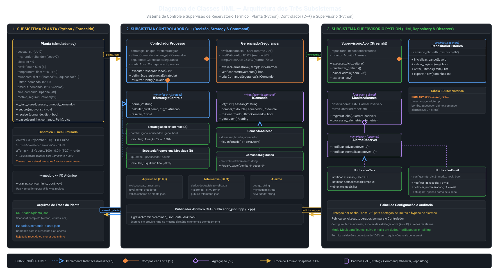
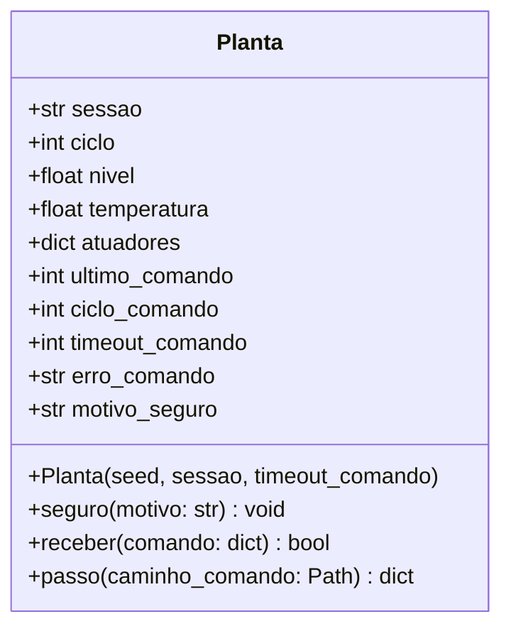
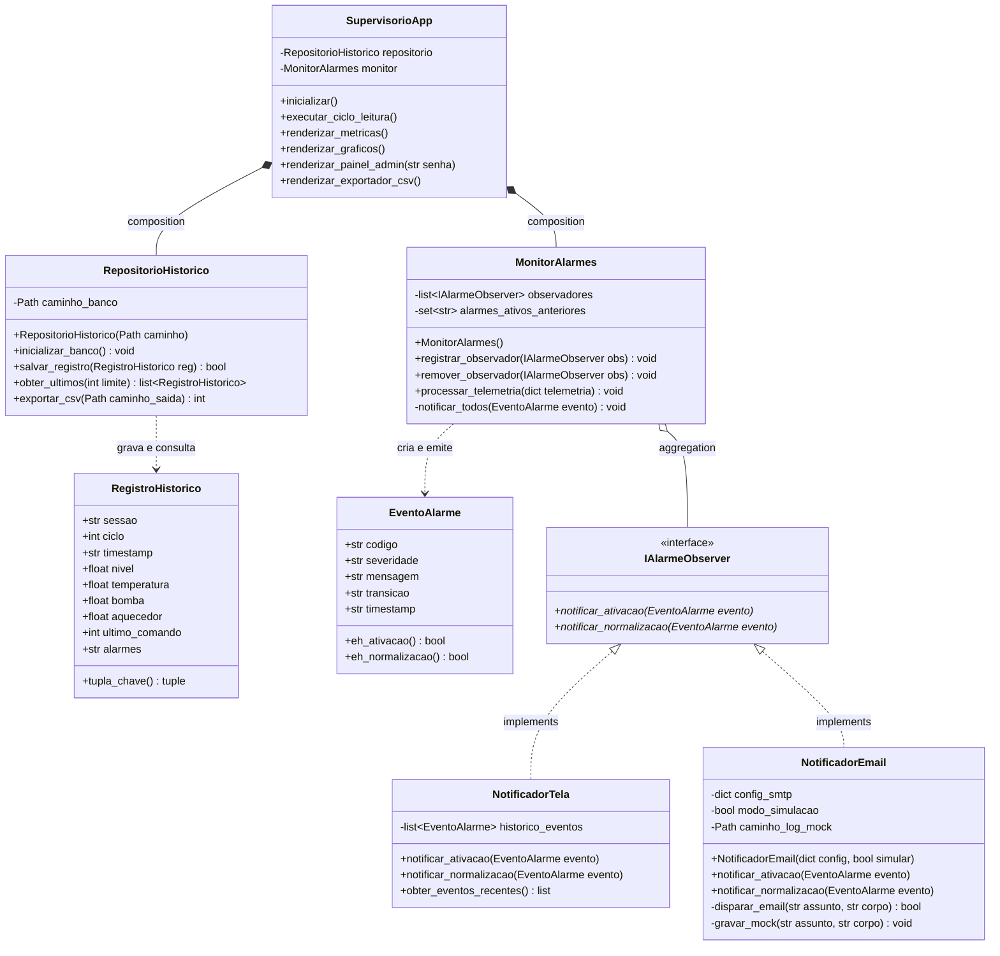

# Modelagem Orientada a Objetos — Diagrama de Classes UML

Este documento apresenta o modelo estático e a arquitetura de classes orientada a objetos do projeto, detalhando os componentes do **Controlador C++** e do **Supervisório Python**, seus atributos, métodos, visibilidades e relacionamentos (Herança, Realização de Interface, Composição e Dependência).

---

## Imagem Vetorial do Diagrama de Classes

Abaixo está a renderização vetorial de alta definição da arquitetura do sistema:



---

## 1. Visão Geral da Arquitetura por Módulos

O sistema é dividido em três subsistemas:
1. **Subsistema Planta (`planta/simulador.py` - Fornecido):** Responsável por simular a física do reservatório térmico, ruídos estocásticos e aplicação de comandos de atuação.
2. **Subsistema Controlador (C++ - Autoral):** Responsável pela validação do contrato, segurança física, estratégias de controle e despacho de comandos.
3. **Subsistema Supervisório (Python - Autoral):** Responsável pela apresentação em IHM (Streamlit), persistência histórica (SQLite) e notificação de eventos (Observer).

```mermaid
graph TD
    subgraph Planta_Externa ["Processo Planta (planta/simulador.py)"]
        PL[Planta Tanque Físico]
    end

    subgraph Cpp_Controlador ["Subsistema Controlador (C++)"]
        CTRL[ControladorProcesso]
        STRAT["<<interface>> IEstrategiaControle"]
        CMD["<<interface>> IComando"]
        SEC[GerenciadorSeguranca]
        VAL[ValidadorContrato]
    end

    subgraph Py_Supervisor ["Subsistema Supervisório (Python)"]
        APP[SupervisorioApp Streamlit]
        REPO[RepositorioHistorico SQLite]
        MON[MonitorAlarmes Subject]
        OBS["<<interface>> IAlarmeObserver"]
        MAIL[NotificadorEmail]
        UIOBS[NotificadorTela]
    end

    PL -- "planta.json" --> VAL
    VAL --> CTRL
    CTRL --> SEC
    CTRL --> STRAT
    STRAT --> CMD
    CMD -- "comando_planta.json" --> PL
    CTRL -- "telemetria.json" --> APP
    APP --> REPO
    APP --> MON
    MON --> OBS
    OBS <|-- MAIL
    OBS <|-- UIOBS
    APP -- "solicitacao_operador.json" --> CTRL
```

---

## 2. A Classe Planta Fornecida (`planta/simulador.py`) e o Acoplamento de Contrato

A classe `Planta` já fornecida no projeto define os dados gerados e esperados:



### Correspondência Estrita de Contrato entre Planta e Controlador:
| Dado / Operação da `Planta` | Representação no Controlador C++ | Garantia Arquitetural |
|---|---|---|
| Retorno de `passo()` $\rightarrow$ `planta.json` | Classe `Aquisicao` (parse e validação) | Campos `versao`, `sessao`, `ciclo`, `timestamp`, `leituras` (LT-01 e TT-01), `atuadores`, `ultimo_comando` e `motivo_seguro`. |
| Entrada de `receber()` $\leftarrow$ `comando_planta.json` | Interface `IComando` / `ComandoAtuacao` | Produz JSON com `versao: 1`, `sessao` ativa, `id` sequencial estritamente maior que `ultimo_comando`, e percentuais `bomba` e `aquecedor` $\in [0.0, 100.0]$. |
| Confirmação em `self.ultimo_comando` | Método `IComando::foiConfirmado(...)` | O controlador aguarda e verifica se o ID emitido foi refletido em `planta.json` do ciclo subsequente (*"emissão não prova aplicação"*). |
| Timeout de 5 ciclos sem comando novo | Mecanismo de Heartbeat / Despacho contínuo | O controlador despacha um novo ID a cada ciclo válido, evitando que a planta entre em `comando_expirado` involuntariamente. |

---

## 3. Diagrama de Classes do Controlador C++ (Strategy & Command)

Abaixo está o diagrama formal UML em formato Mermaid cobrindo as entidades de domínio, os padrões **Strategy** e **Command**, e os serviços de validação e segurança:

```mermaid
classDiagram
    direction TB

    %% Domínio e Dados
    class Medicao {
        -double valor_
        +Medicao(double v)
        +double valor() const
        +bool ehValido() const
    }

    class Atuacao {
        -double bomba_
        -double aquecedor_
        +Atuacao(double b, double a)
        +double bomba() const
        +double aquecedor() const
    }

    class Alarme {
        -string codigo_
        -string mensagem_
        -string severidade_
        +Alarme(string cod, string msg, string sev)
        +string codigo() const
        +string mensagem() const
        +string severidade() const
    }

    class Aquisicao {
        -int versao_
        -string sessao_
        -int ciclo_
        -string timestamp_
        -double nivel_
        -double temperatura_
        -Atuacao atuadores_
        -int ultimoComando_
        -string motivoSeguro_
        +Aquisicao()
        +bool validar() const
        +int ciclo() const
        +string sessao() const
        +double nivel() const
        +double temperatura() const
        +int ultimoComando() const
    }

    class ConfiguracaoOperador {
        +int versao
        +int id
        +string estrategia
        +double nivelMin
        +double nivelMax
        +double tempMin
        +double tempMax
        +bool validar() const
    }

    %% Padrão Strategy
    class IEstrategiaControle {
        <<interface>>
        +~IEstrategiaControle()*
        +nome() string*
        +calcular(double nivel, double temp, ConfiguracaoOperador config) Atuacao*
        +resetar() void*
    }

    class EstrategiaFaixaHisterese {
        -bool bombaLigada_
        -bool aquecedorLigado_
        +EstrategiaFaixaHisterese()
        +nome() string
        +calcular(double nivel, double temp, ConfiguracaoOperador config) Atuacao
        +resetar() void
    }

    class EstrategiaProporcionalModulada {
        -double kpBomba_
        -double kpAquecedor_
        -const double BOMBA_EQUILIBRIO = 33.33
        +EstrategiaProporcionalModulada()
        +nome() string
        +calcular(double nivel, double temp, ConfiguracaoOperador config) Atuacao
        +resetar() void
    }

    IEstrategiaControle <|.. EstrategiaFaixaHisterese : implements
    IEstrategiaControle <|.. EstrategiaProporcionalModulada : implements

    %% Padrão Command
    class IComando {
        <<interface>>
        +~IComando()*
        +id() int*
        +sessao() string*
        +bomba() double*
        +aquecedor() double*
        +foiConfirmado(int ultimoComandoConfirmado) bool*
        +gerarJson() string*
    }

    class ComandoAtuacao {
        -int id_
        -string sessao_
        -double bomba_
        -double aquecedor_
        +ComandoAtuacao(int id, string sessao, double b, double a)
        +id() int
        +sessao() string
        +bomba() double
        +aquecedor() double
        +foiConfirmado(int ultimoComando) bool
        +gerarJson() string
    }

    class ComandoSeguranca {
        -int id_
        -string sessao_
        -double bomba_
        -double aquecedor_
        -string motivo_
        +ComandoSeguranca(int id, string sessao, double b, double a, string motivo)
        +id() int
        +sessao() string
        +bomba() double
        +aquecedor() double
        +foiConfirmado(int ultimoComando) bool
        +gerarJson() string
        +string motivo() const
    }

    IComando <|.. ComandoAtuacao : implements
    IComando <|.. ComandoSeguranca : implements

    %% Orquestrador e Serviços
    class GerenciadorSeguranca {
        -double limiteNivelBaixo_
        -double limiteNivelAlto_
        -double limiteTempBaixa_
        -double limiteTempAlta_
        +GerenciadorSeguranca()
        +avaliarAlarmes(double nivel, double temp) vector~Alarme~
        +verificarIntertravamento(double nivel, double temp, int proximoId, string sessao, unique_ptr~IComando~& outCmd) bool
    }

    class ControladorProcesso {
        -unique_ptr~IEstrategiaControle~ estrategia_
        -unique_ptr~IComando~ ultimoComandoEmitido_
        -ConfiguracaoOperador configAtiva_
        -GerenciadorSeguranca seguranca_
        -int proximoIdComando_
        -int ultimoCicloProcessado_
        +ControladorProcesso()
        +definirEstrategia(unique_ptr~IEstrategiaControle~ novaEstrategia)
        +executarPasso(string dirDados) int
        -atualizarConfiguracao(string dirDados)
    }

    ControladorProcesso *-- IEstrategiaControle : composition
    ControladorProcesso *-- IComando : composition
    ControladorProcesso *-- GerenciadorSeguranca : composition
    ControladorProcesso ..> Aquisicao : uses
    ControladorProcesso ..> Alarme : creates
```



---

## 4. Diagrama de Classes do Supervisório Python (Repository & Observer)

Abaixo está o diagrama formal UML em formato Mermaid cobrindo os módulos do Supervisório Python, implementando os padrões **Repository** (persistência SQLite) e **Observer** (gerenciamento e disparo de alarmes e e-mails):



---

## 5. Representação Estruturada em Texto (ASCII)

Para consulta direta em terminais ou ambientes sem renderização gráfica:

```text
====================================================================================================
                              SUBSISTEMA PLANTA PYTHON (FORNECIDO)
====================================================================================================

      +-------------------------------------------------------------+
      |                           Planta                            |
      |                    (planta/simulador.py)                    |
      +-------------------------------------------------------------+
      | - sessao: str (UUID)                                        |
      | - rng: random.Random(seed=7)                                |
      | - ciclo: int = 0                                            |
      | - nivel: float = 50.0 (%)                                   |
      | - temperatura: float = 25.0 (°C)                            |
      | - atuadores: dict = {"bomba": 0.0, "aquecedor": 0.0}        |
      | - ultimo_comando: int = 0                                   |
      | - timeout_comando: int = 5 (ciclos)                         |
      | - erro_comando: Optional[str]                               |
      | - motivo_seguro: Optional[str]                              |
      +-------------------------------------------------------------+
      | + seguro(motivo: str): void                                 |
      | + receber(comando: dict): bool                              |
      | + passo(caminho_comando: Path): dict                        |
      +-------------------------------------------------------------+
            │                                         ▲
            │ gera planta.json                        │ consome comando_planta.json
            ▼                                         │
====================================================================================================
                              SUBSISTEMA CONTROLADOR C++ (POO)
====================================================================================================

               +-------------------------------------------------------------+
               |                  <<interface>>                              |
               |               IEstrategiaControle                           |
               +-------------------------------------------------------------+
               | + nome(): string                                            |
               | + calcular(nivel: double, temp: double, cfg): Atuacao       |
               | + resetar(): void                                           |
               +-------------------------------------------------------------+
                                       ^               ^
                                       |               |
        +------------------------------+               +-------------------------------+
        |                                                                              |
+-----------------------------------+                         +-----------------------------------+
|     EstrategiaFaixaHisterese      |                         |   EstrategiaProporcionalModulada  |
+-----------------------------------+                         +-----------------------------------+
| - bombaLigada: bool               |                         | - kpBomba: double                 |
| - aquecedorLigado: bool           |                         | - kpAquecedor: double             |
| - BOMBA_EQUILIBRIO = 33.33        |                         |                                   |
+-----------------------------------+                         +-----------------------------------+
| + calcular(...): Atuacao          |                         | + calcular(...): Atuacao          |
+-----------------------------------+                         +-----------------------------------+

               +-------------------------------------------------------------+
               |                  <<interface>>                              |
               |                    IComando                                 |
               +-------------------------------------------------------------+
               | + id(): int                                                 |
               | + sessao(): string                                          |
               | + bomba(): double                                           |
               | + aquecedor(): double                                       |
               | + foiConfirmado(ultimoComandoConfirmado: int): bool         |
               | + gerarJson(): string                                       |
               +-------------------------------------------------------------+
                                       ^               ^
                                       |               |
        +------------------------------+               +-------------------------------+
        |                                                                              |
+-----------------------------------+                         +-----------------------------------+
|          ComandoAtuacao           |                         |         ComandoSeguranca          |
+-----------------------------------+                         +-----------------------------------+
| - id: int                         |                         | - id: int                         |
| - sessao: string                  |                         | - motivo: string                  |
| - bomba: double                   |                         | - bomba: double (0% ou 100%)      |
| - aquecedor: double               |                         | - aquecedor: double (0%)          |
+-----------------------------------+                         +-----------------------------------+
| + foiConfirmado(...): bool        |                         | + foiConfirmado(...): bool        |
| + gerarJson(): string             |                         | + gerarJson(): string             |
+-----------------------------------+                         +-----------------------------------+

====================================================================================================
                              SUBSISTEMA SUPERVISÓRIO PYTHON (POO)
====================================================================================================

      +-----------------------------+                 +-----------------------------+
      |    RepositorioHistorico     |                 |       MonitorAlarmes        |
      |         (Repository)        |                 |          (Subject)          |
      +-----------------------------+                 +-----------------------------+
      | - caminho_banco: Path       |                 | - observadores: list        |
      +-----------------------------+                 | - ativos_anteriores: set    |
      | + inicializar_banco()       |                 +-----------------------------+
      | + salvar_registro(reg)      |                 | + registrar(obs)            |
      | + obter_ultimos(limite)     |                 | + processar(telemetria)     |
      | + exportar_csv(caminho)     |                 +-----------------------------+
      +-----------------------------+                                │
                                                                     │ notifica
                                                                     ▼
                                                      +-----------------------------+
                                                      |        <<interface>>        |
                                                      |       IAlarmeObserver       |
                                                      +-----------------------------+
                                                      | + notificar_ativacao(evt)   |
                                                      | + notificar_normalizacao()  |
                                                      +-----------------------------+
                                                                     ▲
                                             ┌───────────────────────┴───────────────────────┐
                                             │                                               │
                              +-----------------------------+                 +-----------------------------+
                              |       NotificadorTela       |                 |      NotificadorEmail       |
                              +-----------------------------+                 +-----------------------------+
                              | + notificar_ativacao(...)   |                 | - modo_simulacao: bool      |
                              | + notificar_normalizacao()  |                 +-----------------------------+
                              +-----------------------------+                 | + notificar_ativacao(...)   |
                                                                              | + notificar_normalizacao()  |
                                                                              | - disparar_email(...)       |
                                                                              +-----------------------------+
```

---

## 6. Dicionário de Relacionamentos e Princípios Demonstrados

1. **Herança / Polimorfismo Real (`IEstrategiaControle` e `IComando`):**
   * As classes derivadas substituem perfeitamente a interface base (Princípio de Substituição de Liskov - LSP).
   * Destrutores virtuais em C++ asseguram a correta liberação de memória polimórfica.
2. **Composição Forte (`ControladorProcesso *-- IEstrategiaControle` e `*-- IComando`):**
   * O ciclo de vida dos comandos e instâncias de estratégia é gerenciado com segurança via `std::unique_ptr`, prevenindo vazamento de recursos e garantindo posse exclusiva.
3. **Agregação e Desacoplamento (`MonitorAlarmes o-- IAlarmeObserver`):**
   * Os observadores são injetados em tempo de execução no `MonitorAlarmes`. É possível plugar novos observadores (ex.: notificador SMS ou Discord) sem modificar o monitor.
4. **Isolamento de Persistência (`RepositorioHistorico`):**
   * O banco SQLite com chave composta `(sessao, ciclo)` garante idempotência na inserção e desonera o Streamlit de qualquer código SQL.
